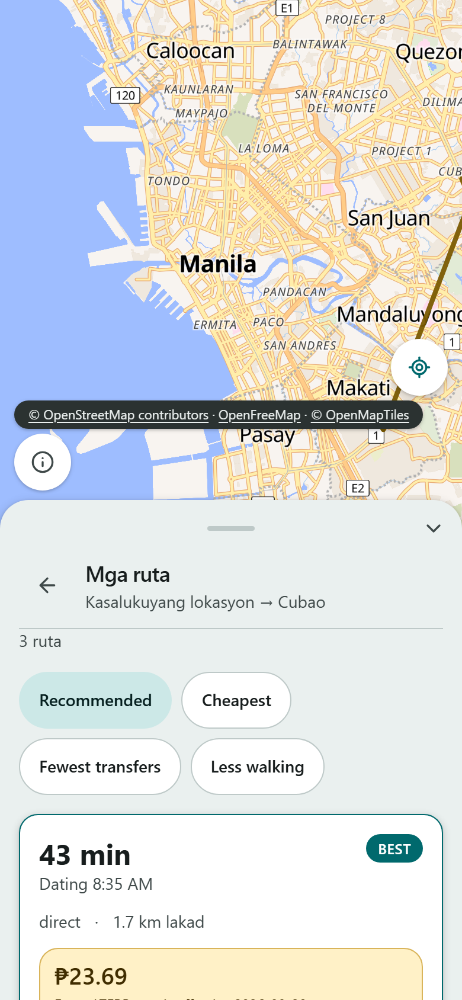
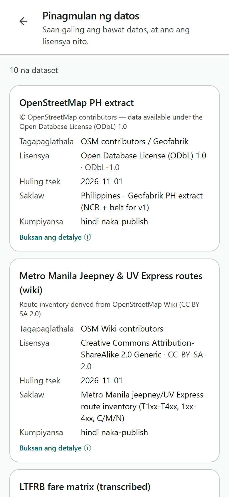

# BiyaHey!

An open-source, local-first commute planner for Metro Manila — an installable
PWA. Search a place, compare the best 3–5 jeepney / bus / rail / ferry options
with **honest fares and visible data provenance**, follow step-by-step sakay
instructions, and save trips that still open offline.

BiyaHey! is built in the open with [BetterGov](https://bettergov.ph)
conventions: MIT code, open data, Conventional Commits, and an explicit
AI-assisted-work disclosure.

> **Status (2026-11-02):** Plan 1 (data spine + router + BFF) and Plan 2 (PWA)
> are complete on `feature/pwa-mvp`. Phase-2 acceptance is **PARTIAL** by
> measurement, not by omission: spec §3 criteria 2–6 pass, while the §11
> performance budget is recorded as PARTIAL — the interactive-map target and TBT
> are not met and are documented with numbers in
> `docs/runbooks/phase2-acceptance.md`. Nothing is pushed or merged.

## Screenshots

Captured from the running app at **390 × 844** (Pixel 7, 2× DPR) with the live
local stack. These are real screenshots, not mockups:
`node apps/web/scripts/screenshots.mjs` regenerates them after UI changes.

| Home | Search | Route options |
|:---:|:---:|:---:|
| <a href="docs/screenshots/home.png"></a> | <a href="docs/screenshots/search-results.png"></a> | <a href="docs/screenshots/route-options.png"></a> |
| Map + sheet, search pill | Grouped stops/landmarks/routes | Fare, ETA, effectivity date |

| Trip detail | Saved | About data |
|:---:|:---:|:---:|
| <a href="docs/screenshots/trip-detail.png"></a> | <a href="docs/screenshots/saved.png"></a> | <a href="docs/screenshots/about-data.png"></a> |
| Step-by-step legs, signage, fare breakdown | Offline-capable snapshots | Provenance for every dataset |

The approved design reference is the **Option A** mockup
[`.superpowers/mockups/option-a-maps-faithful.html`](.superpowers/mockups/option-a-maps-faithful.html)
(full-bleed map + standard bottom sheet); the implementation follows its
container, not Google's data.

## Features

- **Fare-first route cards** — every option leads with the total time, arrival,
  **₱ fare**, transfers, walk distance and mode chips, and every fare shows its
  `effective_from` date and its source. No fare is ever shown without either.
- **Provenance in three layers** — a map/tile credit and a route-card chip (L1),
  the About-data dataset list with publisher, SPDX licence, last-checked date and
  coverage (L2), and a licence sheet with the full source URL (L3). Every string
  comes from the API's `sources[]`, never from a hardcoded attribution table.
- **Step-by-step trips** — an expandable leg timeline (walk / jeep / bus / rail /
  ferry / wait) with the alight stop pinned, "Look for:" signage on board legs, a
  landmark line, and an itemised fare breakdown with effectivity dates.
- **Saved trips that work offline** — a saved trip keeps its fare snapshot and
  dataset version, survives a reload with the network cut, and labels itself
  "Saved route (no live data)" with an honest staleness stamp.
- **Installable PWA** — Workbox service worker, precached app shell, web app
  manifest with 192/512/maskable icons; the offline reload is proven by a
  Playwright test against the built app (not inferred from file existence).
- **Honest Taglish UI** — the default locale is Taglish with an English fallback
  string set, `<html lang="tl">`, correct language tagging and WCAG 2.2 AA
  targets (48 dp entry points, focus management, reduced motion, axe tests).

## Quick start (complete local stack + PWA)

### Prerequisites

- **Node 22+** (this checkout runs **Node 24.19.0**, npm **11.17.0**)
- **Docker Desktop** with Compose v2 (MOTIS + the API image)
- **Python 3.10+** for the data pipeline (this machine: 3.10.11)
- **Java 21+** only if you want to run MobilityData `gtfs-validator` locally
  (CI also runs it; see `.github/workflows/data.yml`)
- Windows PowerShell is enough — **no bash/WSL required**

### 1. Install dependencies

```powershell
npm ci
```

### 2. Create the pipeline virtualenv (once)

```powershell
cd pipelines
python -m venv .venv
.\.venv\Scripts\python.exe -m pip install --upgrade pip
.\.venv\Scripts\python.exe -m pip install -r requirements.txt
cd ..
```

### 3. Build the data (one-time, ~90 minutes on this machine)

```powershell
npm run data:build
```

That runs `download → osm → publish` from the repository root, passing the
documented landmark aliases. The Geofabrik download is ~612 MB; the NCR clip is
the slow part (~72 min; see `docs/runbooks/data-build.md` for measured timings
and every generated artifact). Subsequent iterations can reuse inputs:

```powershell
npm run data:build -- --skip-download    # reuse the PH extract, re-clip + publish
npm run data:build -- --publish-only     # reuse the NCR clip, rebuild the feed
```

`data/build/` and `data/snapshots/` are gitignored — **never commit generated
data**.

### 4. Start the services

```powershell
docker compose up -d --wait      # routing :8080 + api :8787, waits for health
# or the checked wrapper (validates data/build first and prints the URLs):
npm run dev
```

### 5. Start the PWA

In a second terminal:

```powershell
npm run dev --workspace @biyahey/web    # http://localhost:5173
```

Open **<http://localhost:5173>**. The app calls the BFF at
`http://localhost:8787` by default; override with `VITE_API_URL` before starting
Vite. `:5173` is the origin in the API's CORS allow-list.

### 6. Verify

```powershell
npm run ci                      # lint + typecheck + offline tests + data schemas + fare staleness
npm run test:e2e                # builds, then Playwright against the live stack
npm run verify:phase2           # phase-2 acceptance (spec §3 criteria 2–6; performance PARTIAL)
npm run verify:phase1           # full phase-1 acceptance (expect PARTIAL)
npm run perf:web                # Lighthouse mobile, 5-run median (expect exit 1 on TBT)
```

`docs/runbooks/local-dev.md` is the full local guide: prerequisites, every
command, Windows notes and troubleshooting (ports, CORS, the MapLibre worker,
PWA preview vs dev, Lighthouse host contention).

## Repository layout

```
apps/web/            # React 19 + Vite PWA: Option A map + sheet, all six screens
services/api/        # Fastify BFF (TypeScript)
services/routing/    # pinned MOTIS Docker image + config
packages/shared/     # browser-safe DTOs, fare engine, attribution helper
pipelines/           # Python data build (download/osm/publish/coverage/licence-gate)
data/                # provenance registry, fares, curated routes (build output gitignored)
docs/                # research, specs, plans, runbooks, screenshots, handoff
scripts/             # dev/data:build/checks/smoke/acceptance harnesses
```

## Data provenance and licences

Every dataset is registered in `data/provenance/sources.yaml` and returned by
`/sources`; `/plan` only cites datasets the returned itineraries actually used.

| Asset | Licence | Notes |
|---|---|---|
| Repository code (`packages/`, `services/`, `apps/`, `pipelines/`, `scripts/`) | **MIT** (`LICENSE`) | |
| Generated GTFS database (`data/build/gtfs/gtfs.zip`) | **ODbL 1.0** | derived from OpenStreetMap; the notice ships inside the zip (`LICENSE-DATA.txt`) |
| Curated jeepney/UV inventory (`data/routes/jeepney-inventory.yaml`) | **CC BY-SA 2.0** | OSM Wiki; any GTFS derived from it states the attribution inside the artifact |
| Fare matrices (`data/fares/`) | Government public information, transcribed | LTFRB / LRTA / LRMC / MMDA; effectivity dates are always displayed |
| Documentation (`docs/`, `README.md`, `CONTRIBUTING.md`) | **CC BY 4.0** | includes the screenshots |

Details: `data/LICENSE-DATA.md`, `data/provenance/PROVENANCE_NOTES.md`, and the
runbooks' known-gaps sections. Sakay/PTAC 2014 GTFS, BusMaps and any feed
without a reuse grant are **never shipped**.

## Known gaps (recorded, not hidden)

- **Performance is PARTIAL.** The paint-only budget passes (104.4 KB gzip vs
  250 KB), but the spec §11 "cold start → interactive map ≤ 3 s" target is **not
  met**, TBT is above the Lighthouse "good" guidance, the ≤ 40 tiles/viewport
  budget is measured but not enforced, and the `saveData` raster fallback is not
  implemented. The CI `perf` job is authoritative; see
  `docs/runbooks/phase2-acceptance.md` §5.
- **Data gaps.** Coverage is 12/16 curated routes; PNR and non-PRFS ferries are
  excluded from the v1 feed and counted; P2P is formally deferred; the LRT-2 fare
  band is provisional (`needs_verification: true`); a plausibility guard mitigates
  bad OSM shapes until the GTFS is rebuilt. See
  `docs/runbooks/phase1-acceptance.md` §8.
- **UI gaps for public beta.** Home's peek sheet does not yet list recent trips
  (spec screen 1), the English-fallback toggle has no settings UI (spec §11), and
  mixed Taglish/English sentences are tagged as one primary language (R81). All
  are listed in `docs/runbooks/phase2-acceptance.md` §5.

## Contributing

Read `CONTRIBUTING.md` and `CODE_OF_CONDUCT.md`. AI-assisted contributions are
welcome and must be disclosed (see `AI_DISCLOSURE.md` and the PR template).
Data changes must pass `npm run validate:data`, the licence gate, and (when they
touch the feed) the pipeline tests. UI changes have their own conventions —
Option A container, fare-first cards, API-only provenance, `t()`-only copy,
accessibility checklist, performance budget — in `CONTRIBUTING.md`.

## Licence

Code is MIT. Derived transit data is ODbL 1.0 with attribution; the wiki-derived
route inventory is CC BY-SA 2.0. Documentation and screenshots are CC BY 4.0.
