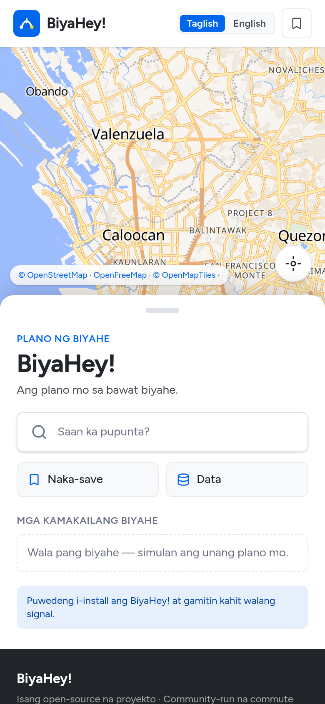
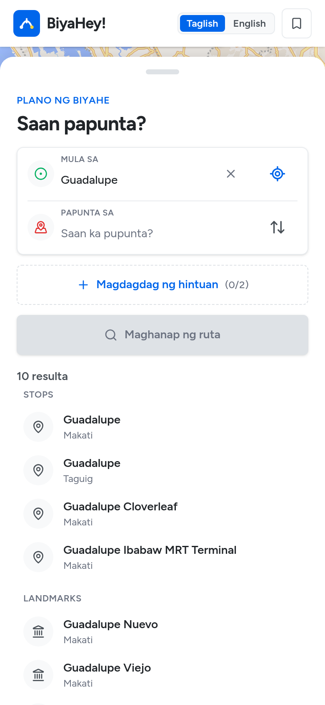
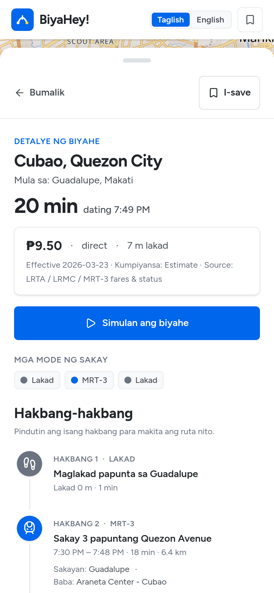
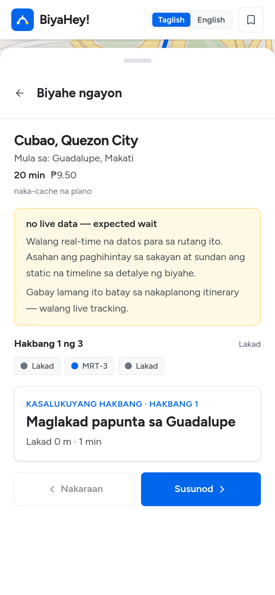
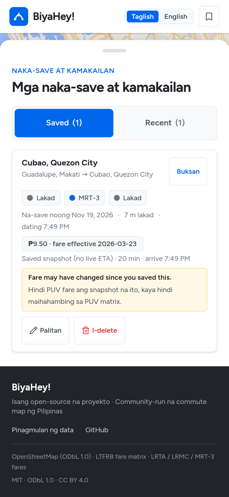
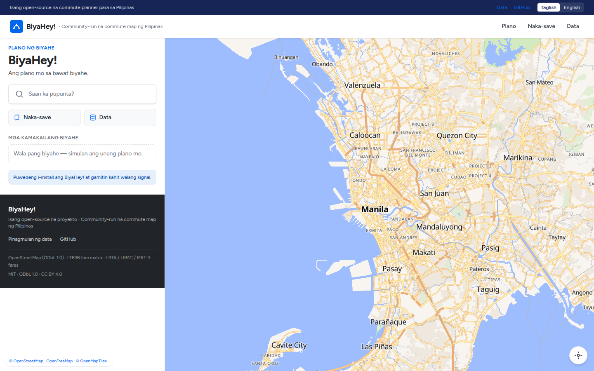
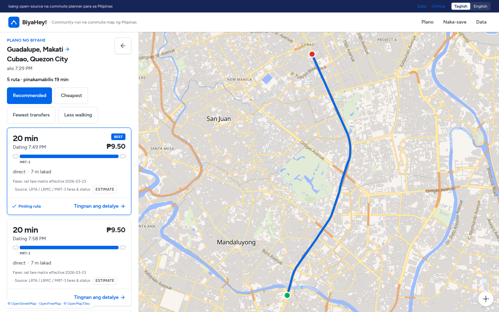

# BiyaHey!

An open-source, local-first commute planner for the Philippines — an installable
PWA. Search a place,
compare the best jeepney / bus / rail / ferry options with **honest fares and
visible data provenance**, follow step-by-step sakay instructions, and save
trips that still open offline.

The default voice is **Taglish**, with an English toggle. BiyaHey! is honest
about what it is not: there is no realtime data anywhere in the app — schedules
and fare matrices only, stated plainly in the UI.

## Open source

BiyaHey! is an independent, open-source application: there is no corporate,
government or institutional affiliation behind it, and it is not part of any
other portal or app family. The code is MIT-licensed (see [LICENSE](LICENSE)),
every dataset it uses is registered with its publisher and licence, and
contributions are welcome (see [CONTRIBUTING.md](CONTRIBUTING.md)).

The UI is Tailwind v4 on an app-owned token set in
[`apps/web/src/theme.css`](apps/web/src/theme.css) — BiyaHey blue **`#0066eb`**,
the **Figtree** typeface and a light canvas. The deployment contract is in
[docs/INTEGRATION.md](docs/INTEGRATION.md).

## Features

- **Map-first, one screen** — a persistent MapLibre map behind a mobile bottom
  sheet (desktop gets a 400 px sidebar): search, route options, trip detail,
  the live walkthrough, saved trips and the data page all render in the panel.
- **Directions form with stops** — From and To, up to two optional served-stop
  "via" stops, swap and one-tap current location; the trip lives in the URL, so
  back/edit links always work.
- **Fare-first route options** — 3–5 ranked alternatives leading with duration,
  arrival, **₱ fare**, transfers and walk distance. Every fare shows its
  effectivity date and source.
- **Step-by-step trips on the map** — a leg timeline with board/alight stops,
  itemised fares and a map that follows the focused leg. The walkthrough always
  states there is no realtime data and never invents a live ETA.
- **Saved trips that work offline** — save a trip with its fare and dataset
  snapshot; it reopens after a reload with the network cut and labels itself as
  a saved snapshot with a staleness stamp.
- **Provenance in the app** — every dataset, publisher, licence, coverage and
  last-checked date comes from the BFF's `/sources`; About data lists what
  actually exists.
- **Honest Taglish UI, installable PWA** — mobile-first, WCAG 2.2 AA targets,
  English fallback, app-shell service worker and a web app manifest.

## Screenshots

Captured from the running app with live routing data at **390 × 844** (Pixel 7,
2× DPR) and **1440 × 900**; `node apps/web/e2e/screenshots.mjs` regenerates them
after UI changes.

| Home | Search | Route options |
|:---:|:---:|:---:|
| <a href="docs/screenshots/home.png"></a> | <a href="docs/screenshots/search-results.png"></a> | <a href="docs/screenshots/route-options.png"></a> |
| Map + sheet, search pill | Directions form, grouped results | Fare, ETA, effectivity date |

| Trip detail | Live walkthrough | Saved |
|:---:|:---:|:---:|
| <a href="docs/screenshots/trip-detail.png"></a> | <a href="docs/screenshots/live-trip.png"></a> | <a href="docs/screenshots/saved.png"></a> |
| Timeline, fare breakdown | Guided steps, no fake realtime | Offline-capable snapshots |

| About data | Desktop home | Desktop route options |
|:---:|:---:|:---:|
| <a href="docs/screenshots/about-data.png"></a> | <a href="docs/screenshots/home-desktop.png"></a> | <a href="docs/screenshots/route-options-desktop.png"></a> |
| Provenance for every dataset | Sidebar + full map | Compare options on the map |

## Quick start

Prerequisites: **Node 22+**, **Docker** with Compose v2, and **Python 3.10+**
for the data build.

```bash
npm ci

# One-time data build: downloads the ~612 MB Geofabrik PH extract, clips the
# NCR area and publishes the GTFS/fare artifacts (~90 min on the dev machine;
# see scripts/data-build.mjs and docs/DEVELOPMENT.md).
npm run data:build

# Start the router (:8080) and the BFF (:8787), waiting for both healthchecks.
docker compose up -d --wait        # or the checked wrapper: npm run dev

# In a second terminal, start the app (:5173).
npm run dev --workspace @biyahey/web
```

Open <http://localhost:5173>. The app calls the BFF at
<http://localhost:8787> by default; set `VITE_API_URL` before starting Vite to
change that, and put the browser origin in the BFF's `CORS_ORIGINS`.

### Fast path (phones, other machines, demos)

The Vite dev server serves ~22 MB of uncompressed modules — fine on localhost,
slow over Wi-Fi. To open the app from a phone or another machine, serve the
production build instead:

```bash
npm run preview:web:watch     # build + serve the PWA on :8099, rebuild on save
```

The preview server (`scripts/serve-web.mjs`) answers with brotli-compressed,
immutably cached assets and proxies `/api` to the BFF on the same origin, so a
cold load is ~0.5 MB and a repeat visit is served from the service worker. On
the dev VM the tailnet URLs <https://devvm1.tailf19a1a.ts.net/> and
`:8443` already point at it. Numbers, cache policy and the audit harness
(`npm run perf:audit`) are in [docs/PERFORMANCE.md](docs/PERFORMANCE.md).

Before opening a PR, run `npm run ci` (lint, typecheck, offline tests, data
schemas, fare staleness). `npm run build` produces the static PWA in
`apps/web/dist`. Everything else — repo layout, commands, data build, env vars
and how screens route — is in [docs/DEVELOPMENT.md](docs/DEVELOPMENT.md).

## Data provenance and licences

Every dataset is registered in `data/provenance/sources.yaml` and returned by
`/sources`. `/plan` cites the datasets each itinerary actually used; no fare is
shown without its source and effectivity date. Details:
[data/LICENSE-DATA.md](data/LICENSE-DATA.md).

| Asset | Licence | Notes |
|---|---|---|
| Repository code (`apps/`, `services/`, `packages/`, `pipelines/`, `scripts/`) | **MIT** ([LICENSE](LICENSE)) | |
| Generated GTFS feed (`data/build/gtfs/gtfs.zip`) | **ODbL 1.0** | derived from OpenStreetMap; the notice ships inside the zip |
| Curated jeepney/UV inventory (`data/routes/`) | **CC BY-SA 2.0** | OSM Wiki; attribution ships inside the GTFS |
| Fare matrices (`data/fares/`) | government public information, transcribed | LTFRB / LRTA / LRMC / MRT-3; effectivity dates always displayed |
| Documentation (`docs/`, `README.md`, `CONTRIBUTING.md`) | **CC BY 4.0** | includes the screenshots |

Sakay/PTAC 2014 GTFS, BusMaps and any feed without a reuse grant are **never**
shipped. Data changes must pass `npm run validate:data` and the licence gate in
CI (`.github/workflows/licence-gate.yml`).

## Known limits

- **No realtime data.** Routes, schedules and fares are planned data; there are
  no live vehicle positions or live ETAs, and the live walkthrough says so.
- **Fare gaps.** Some legs have no published fare ("fare not published"), the
  LRT-2 fare band is provisionally transcribed (`needs_verification: true`), and
  not every PH corridor is modelled in the feed.
- **Walk fallback.** Where the feed has no usable transit chain, the BFF returns
  a clearly-labelled **walking estimate** — not a served route — with a
  distance warning instead of an empty result or a fabricated ride.
- **Mapping gaps.** OSM/GTFS coverage is uneven outside Metro Manila; the data
  page shows the datasets that exist rather than implying national completeness.

## Contributing

Read [CONTRIBUTING.md](CONTRIBUTING.md) and the
[Code of Conduct](CODE_OF_CONDUCT.md). AI-assisted contributions are welcome and
must be disclosed — see [AI_DISCLOSURE.md](AI_DISCLOSURE.md) and the PR
template.
